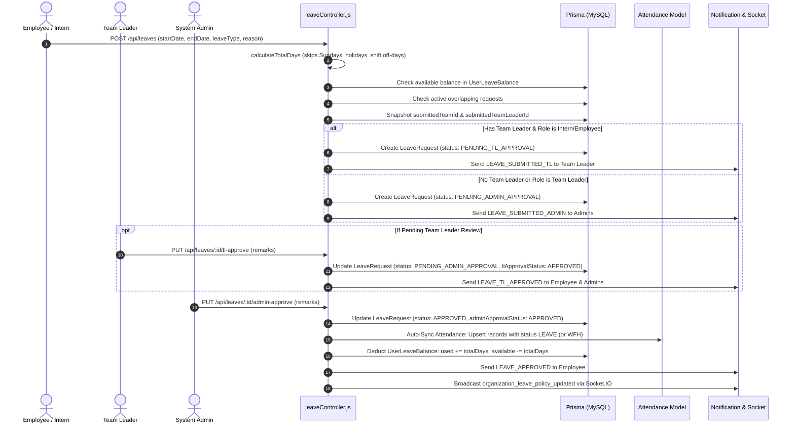
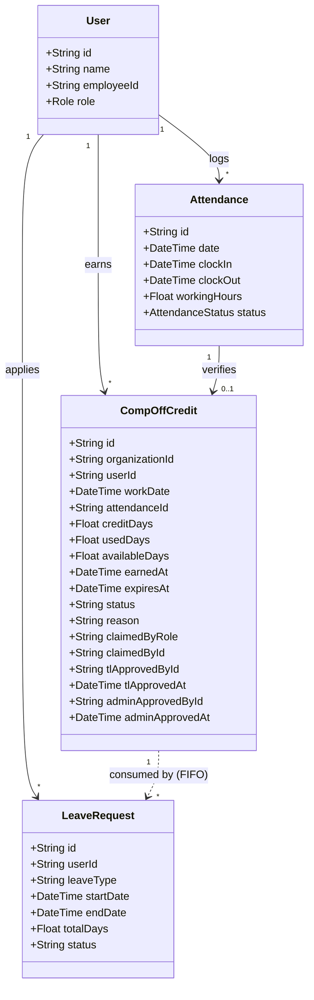

# InnovEity CRM — Compensatory Leave (Comp-Off)
## Phase 1: Existing Codebase Technical Analysis

**Document Status:** Complete & Verified Against Codebase  
**Execution Safety Status:** Zero Mutations Performed (Read-Only Analysis Only)  
**Target Architecture:** Multi-Tenant Enterprise CRM (Node.js / Express / Prisma ORM / MySQL 8.0+ / Socket.IO / React 18 / Vite)  

---

## 1. Architecture Summary

### 1.1 Technology Stack Overview
- **Frontend Architecture:**
  - **Framework & Build:** React 18 SPA bundled via Vite 5 (`frontend/vite.config.js`).
  - **Styling & UI:** TailwindCSS 3.4 (`frontend/tailwind.config.js`), PostCSS, Lucide-react icons, Framer Motion animations.
  - **State & Context Management:**
    - `AuthContext.jsx` (`frontend/src/context/AuthContext.jsx`): Manages authenticated user session, tokens, and current role.
    - `CompanyScopeContext.jsx` (`frontend/src/context/CompanyScopeContext.jsx`): Multi-tenant organization switcher for Super Admin and multi-company operations.
    - `SocketContext.jsx` (`frontend/src/context/SocketContext.jsx`): Real-time Socket.IO connection for push alerts and policy broadcasts.
  - **Networking:** Axios singleton (`frontend/src/services/api.js`) attaching Bearer JWT and `x-company-scope` headers to all outbound requests.
  - **Routing:** React Router DOM v6 (`frontend/src/App.jsx`).

- **Backend Architecture:**
  - **Runtime & Server:** Node.js v24 with Express 4 (`backend/src/index.js`), running on port 5000.
  - **Database & ORM:** MySQL 8.0+ accessed via Prisma ORM v5.12.1 (`backend/prisma/schema.prisma`).
  - **Real-Time WebSockets:** Socket.IO server (`backend/src/socket.js`) broadcasting real-time notification events (`sendNotificationToUser`) and policy updates (`broadcastLeavePolicyUpdate`).
  - **Background Automation:** `node-cron` running background daemons:
    - Auto Clock-Out Daemon (`backend/src/services/autoClockOutService.js`): Executes every minute (`* * * * *`).
    - Monthly Leave Credit Daemon (`backend/src/services/leaveScheduler.js`): Idempotent monthly quota accruals.

- **Module & Security Architecture:**
  - **Multi-Tenancy:** Tenant isolation enforced via `organizationId` foreign keys and scoped utility queries in `backend/src/utils/organizationScope.js` (`getOrganizationWhere`, `getEffectiveOrgId`, `getUserRelationWhere`).
  - **RBAC & Dynamic Permissions:** Dual-layer authorization:
    - Role-based checking (`backend/src/middleware/auth.js` -> `requireRole`).
    - Dynamic permission matrix (`backend/src/middleware/permissionMiddleware.js` -> `requirePermission`) evaluating access levels (`NONE`, `VIEW`, `EDIT`) across modules such as `leave_management`, `attendance`, `work_calendar`, and `self_service`.

---

## 2. Existing Database Models & Data Schemas

The following models are defined in `backend/prisma/schema.prisma` and relate directly to Leave, Attendance, Calendar, and Workforce Planning.

### 2.1 Leave Management Models

#### 1. `LeaveRequest` (`backend/prisma/schema.prisma:882-921`)
- **Table Name:** `leaverequest`
- **Fields:**
  - `id`: `String` (UUID primary key)
  - `userId`: `String` (FK -> `User.id`)
  - `startDate`: `DateTime` (Start date of leave period)
  - `endDate`: `DateTime` (End date of leave period)
  - `totalDays`: `Float` (Default `1.0`, supports decimal values e.g. `0.5` for half-day)
  - `leaveType`: `String` (Default `"CASUAL"`, stores code e.g. `"CASUAL"`, `"SICK"`, `"EMERGENCY"`, `"WFH"`, `"UNPAID"`)
  - `type`: `String` (Default `"LEAVE"`, values: `"LEAVE"`, `"WFH"`)
  - `payType`: `String` (Default `"PAID"`, values: `"PAID"`, `"UNPAID"`)
  - `subject`: `String?`
  - `letterContent`: `String?` (`@db.Text`)
  - `reason`: `String` (`@db.Text`)
  - `contactPhone`: `String?`
  - `submittedTeamId`: `String?` (Snapshot of team ID at submission time)
  - `submittedTeamLeaderId`: `String?` (Snapshot of Team Leader user ID at submission time)
  - `status`: `String` (Default `"PENDING_TL_APPROVAL"`, lifecycle states: `"PENDING_TL_APPROVAL"`, `"PENDING_ADMIN_APPROVAL"`, `"APPROVED"`, `"REJECTED"`, `"CANCELLED"`)
  - `tlApprovalStatus`: `String` (Default `"PENDING"`, states: `"PENDING"`, `"APPROVED"`, `"REJECTED"`, `"NOT_REQUIRED"`)
  - `tlApprovedById`: `String?`
  - `tlApprovedAt`: `DateTime?`
  - `tlRemarks`: `String?`
  - `adminApprovalStatus`: `String` (Default `"PENDING"`, states: `"PENDING"`, `"APPROVED"`, `"REJECTED"`)
  - `adminApprovedById`: `String?`
  - `adminApprovedAt`: `DateTime?`
  - `adminRemarks`: `String?`
  - `createdAt`: `DateTime` (`@default(now())`)
  - `updatedAt`: `DateTime` (`@updatedAt`)
- **Relations:** `user User @relation("UserLeaves", fields: [userId], references: [id], onDelete: Cascade)`

#### 2. `LeavePolicy` (`backend/prisma/schema.prisma:928-941`)
- **Table Name:** `leavepolicy`
- **Fields:**
  - `id`: `String` (UUID primary key)
  - `isGlobal`: `Boolean` (Default `true`)
  - `allocationType`: `LeaveAllocationType` (Enum: `ANNUAL`, `MONTHLY`, default `ANNUAL`)
  - `carryForwardEnabled`: `Boolean` (Default `true`)
  - `maxCarryForwardDays`: `Float` (Default `5.0`)
  - `halfDayAllowed`: `Boolean` (Default `true`)
  - `workingDaysOnly`: `Boolean` (Default `true`)
  - `autoApproval`: `Boolean` (Default `false`)
  - `createdAt`, `updatedAt`: `DateTime`

#### 3. `LeaveType` (`backend/prisma/schema.prisma:943-966`)
- **Table Name:** `leavetype`
- **Fields:**
  - `id`: `String` (UUID primary key)
  - `name`: `String` (`@unique`, e.g. "Casual Leave", "Sick Leave")
  - `code`: `String` (`@unique`, e.g. "CL", "SL", "WFH")
  - `description`: `String?`
  - `color`: `String` (Default `"#3B82F6"`)
  - `icon`: `String` (Default `"Calendar"`)
  - `displayOrder`: `Int` (Default `0`)
  - `isPaid`: `Boolean` (Default `true`)
  - `annualDays`: `Float` (Default `12.0`)
  - `monthlyCreditDays`: `Float` (Default `1.0`)
  - `allowCarryForward`: `Boolean` (Default `false`)
  - `requireDoc`: `Boolean` (Default `false`)
  - `allowHalfDay`: `Boolean` (Default `true`)
  - `isSystem`: `Boolean` (Default `false`, protects system core types from deletion)
  - `isActive`: `Boolean` (Default `true`)
- **Relations:**
  - `userBalances UserLeaveBalance[]`
  - `creditHistories LeaveCreditHistory[]`

#### 4. `UserLeaveBalance` (`backend/prisma/schema.prisma:968-987`)
- **Table Name:** `userleavebalance`
- **Fields:**
  - `id`: `String` (UUID primary key)
  - `userId`: `String` (FK -> `User.id`)
  - `leaveTypeId`: `String` (FK -> `LeaveType.id`)
  - `allocated`: `Float` (Default `0.0`, total days credited for period)
  - `used`: `Float` (Default `0.0`, days consumed via approved leaves)
  - `pending`: `Float` (Default `0.0`, days locked in pending approval requests)
  - `available`: `Float` (Default `0.0`, net days remaining: `allocated + carryForward - used - pending`)
  - `carryForward`: `Float` (Default `0.0`, days brought forward from prior cycle)
  - `expired`: `Float` (Default `0.0`, days that lapsed during reset)
  - `lastCreditedAt`: `DateTime?`
  - `updatedAt`: `DateTime`
- **Constraints:** `@@unique([userId, leaveTypeId])`

#### 5. `LeaveCreditHistory` (`backend/prisma/schema.prisma:989-1005`)
- **Table Name:** `leavecredithistory`
- **Fields:**
  - `id`: `String` (UUID primary key)
  - `userId`: `String`
  - `leaveTypeId`: `String`
  - `creditedDays`: `Float`
  - `creditedOn`: `DateTime` (`@default(now())`)
  - `month`: `Int`, `year`: `Int`
  - `note`: `String?`
- **Constraints:** `@@unique([userId, leaveTypeId, month, year])`

### 2.2 Attendance & Calendar Models

#### 1. `Attendance` (`backend/prisma/schema.prisma:493-536`)
- **Table Name:** `attendance`
- **Fields:**
  - `id`: `String` (UUID primary key)
  - `userId`: `String` (FK -> `User.id`)
  - `date`: `DateTime` (`@db.Date`, stored at UTC midnight)
  - `clockIn`: `DateTime?` (Timestamp of clock-in)
  - `clockOut`: `DateTime?` (Timestamp of clock-out)
  - `workingHours`: `Float?` (Decimal hours, e.g. `8.25`)
  - `status`: `AttendanceStatus` (Enum: `PRESENT`, `LATE`, `HALF_DAY`, `ABSENT`, `LEAVE`, `WORK_FROM_HOME`, `MISSED`)
  - `editedBy`: `String?` (User ID who manually edited record)
  - `lateMinutes`: `Int?`
  - `earlyWindowUsed`: `Int?`, `gracePeriodUsed`: `Int?`
  - `workLocation`: `String?` (`OFFICE`, `HOME`, `OTHER`)
  - `workLocationOther`: `String?`
  - `clockInLatitude`: `Float?`, `clockInLongitude`: `Float?`, `clockInAddress`: `String?`
  - `clockOutLatitude`: `Float?`, `clockOutLongitude`: `Float?`, `clockOutAddress`: `String?`
  - `shiftEndAt`: `DateTime?`
  - `autoClockOut`: `Boolean` (Default `false`)
  - `clockOutReason`: `String?`
  - `shiftId`: `String?`, `shiftName`: `String?`
  - `attendanceLocationId`: `String?` (FK -> `AttendanceLocation.id`)
- **Constraints:** `@@unique([userId, date])`

#### 2. `HolidayCalendar` (`backend/prisma/schema.prisma:1558-1575`)
- **Table Name:** `holidaycalendar`
- **Fields:**
  - `id`: `String` (UUID primary key)
  - `organizationId`: `String?` (FK -> `Organization.id`)
  - `title`: `String`
  - `date`: `DateTime` (`@db.Date`)
  - `type`: `HolidayType` (Enum: `NATIONAL`, `COMPANY`, `WEEKEND`, default `COMPANY`)
  - `isWorkingHoliday`: `Boolean` (Default `false`)
  - `payMultiplier`: `Float` (Default `2.0` for Holiday, `1.5` for Weekend)
  - `remarks`: `String?`
- **Constraints:** `@@unique([organizationId, date])`

#### 3. `WorkCalendar` (`backend/prisma/schema.prisma:1719-1741`)
- **Table Name:** `workcalendar`
- **Fields:**
  - `id`: `String` (UUID primary key)
  - `organizationId`: `String?`
  - `date`: `DateTime?` (`@db.Date`, specific date override)
  - `status`: `WorkCalendarStatus` (Enum: `WORKING_DAY`, `WFH`, `HOLIDAY`)
  - `title`: `String?`, `reason`: `String?`
  - `isPermanent`: `Boolean` (Default `false`)
  - `recurrenceMonth`: `Int?`, `recurrenceDay`: `Int?` (Annual recurring holiday rule)
  - `createdById`: `String?`

#### 4. `Shift` & `ShiftSchedule` (`backend/prisma/schema.prisma:1889-1971`)
- **`Shift`:**
  - `id`: `String`
  - `organizationId`: `String`
  - `name`: `String` (e.g. "Company Default", "Night Shift")
  - `startTime`: `String` (`"HH:mm"`, e.g. `"09:00"`)
  - `endTime`: `String` (`"HH:mm"`, e.g. `"18:00"`)
  - `workingDays`: `Json` (Array of objects: `[{ day: "MONDAY", isWorking: true }, ..., { day: "SATURDAY", isWorking: true, pattern: { "1": "WORKING", "2": "LEAVE", ... } }, { day: "SUNDAY", isWorking: false }]`)
  - `status`: `String` (`"ACTIVE"`, `"INACTIVE"`)
- **`ShiftMember`:** Maps `userId` (unique) to `shiftId`.
- **`ShiftSchedule`:** Temporary shift overrides and roster assignments (`startDate`, `endDate`, `type`: `PLANNED`, `OVERRIDE`, `SWAP`).

### 2.3 Legacy Fields in `User` Model
`backend/prisma/schema.prisma:158-160` defines:
```prisma
casualLeaveQuota    Int  @default(12)
sickLeaveQuota      Int  @default(12)
emergencyLeaveQuota Int  @default(6)
```
*Verification Finding:* These columns are legacy fields preserved from earlier versions of the schema. Active runtime business logic in `leaveController.js` and `leavePolicyController.js` relies exclusively on `UserLeaveBalance` and the JSON store `OrganizationSettings.leavePolicy` / `company_leave_policies.json`.

---

## 3. Existing Leave Workflow Analysis

The end-to-end leave lifecycle is implemented in `backend/src/controllers/leaveController.js` and exposed via routes in `backend/src/routes/leaveRoutes.js`.



### 3.1 Trace of Workflow Stages

1. **Submission (`applyLeave`, lines 531–715):**
   - **Role Check:** Admins and Super Admins are strictly prohibited from applying for leave (`lines 537-539` return `403 Forbidden`).
   - **Date Validation:** Verifies `startDate <= endDate`.
   - **Duration Calculation (`calculateTotalDays`, lines 14–53):**
     - Evaluates each calendar day between `startDate` and `endDate`.
     - Skips Sundays (`curr.getUTCDay() === 0`).
     - Skips company holidays registered in `HolidayCalendar`.
     - Skips shift off-days evaluated by `shiftService.getShiftDayStatus`.
     - Supports `isHalfDay` toggle (`totalDays = 0.5`).
   - **Balance Pre-Check (lines 594–613):**
     - Queries `UserLeaveBalance` for matching `LeaveType`.
     - If `totalDays > availableDays`, immediately rejects with `400 Bad Request`.
   - **Overlap Protection (lines 616–631):**
     - Blocks submission if any existing request for the user in `['PENDING_TL_APPROVAL', 'PENDING_ADMIN_APPROVAL', 'APPROVED']` overlaps the date range.
   - **Hierarchy Routing (lines 634–654):**
     - Captures `submittedTeamId` and `submittedTeamLeaderId` from `TeamMember`.
     - If applicant is `INTERN` or `EMPLOYEE` and has an active Team Leader: routes to `PENDING_TL_APPROVAL`.
     - If applicant is `TEAM_LEADER` or has no Team Leader: routes directly to `PENDING_ADMIN_APPROVAL`.

2. **Team Leader Review (`approveLeaveTL`, lines 718–797):**
   - Restricted to `TEAM_LEADER` or `ADMIN`.
   - Validates that request is currently `PENDING_TL_APPROVAL`.
   - Guards against self-approval (`lines 744-746`) and peer Team Leader approval (`lines 747-749`).
   - Sets `tlApprovalStatus = 'APPROVED'`, `tlApprovedById = req.user.id`, `tlApprovedAt = new Date()`, `status = 'PENDING_ADMIN_APPROVAL'`.
   - Balance is **not** deducted at this stage.

3. **Admin Final Sanction (`approveLeaveAdmin`, lines 800–936):**
   - Restricted strictly to `ADMIN`. Super Admin is explicitly read-only (`lines 807-809` return `403 Forbidden`).
   - Validates that request is in `PENDING_ADMIN_APPROVAL`.
   - Sets `adminApprovalStatus = 'APPROVED'`, `adminApprovedById = req.user.id`, `adminApprovedAt = new Date()`, `status = 'APPROVED'`.
   - **Attendance Auto-Sync (lines 840–885):**
     - Iterates through all dates in the leave window.
     - Upserts `Attendance` record with `date: targetDate`, `status: leaveType === 'WFH' ? 'WORK_FROM_HOME' : 'LEAVE'`, `workingHours: leaveType === 'WFH' ? 8.0 : 0`.
   - **Balance Deduction (lines 895–920):**
     - Matches `leaveType` to active `LeaveType` record.
     - Updates `UserLeaveBalance`:
       `newUsed = userBal.used + totalDays`
       `newAvailable = Math.max(0, userBal.allocated + userBal.carryForward - newUsed)`
   - Dispatches Socket.IO event `organization_leave_policy_updated`.

4. **Rejection (`rejectLeave`, lines 939–1032):**
   - Can occur at either TL stage or Admin stage.
   - Sets `status = 'REJECTED'` and records approver remarks.
   - No attendance records are created and no balance is deducted.

5. **Self-Service Cancellation (`cancelLeave`, lines 1035–1070):**
   - Allowed **only** while request is in `PENDING_TL_APPROVAL` or `PENDING_ADMIN_APPROVAL`.
   - Once approved, employee cannot cancel (`lines 1050-1052` return `400 Bad Request`).
   - Sets `status = 'CANCELLED'`. Since deduction only happens on final Admin approval, no balance restoration calculation is triggered for pending cancellations.

---

## 4. Global Leave Policy Analysis

Implemented across:
- `backend/src/controllers/leavePolicyController.js`
- `backend/src/utils/companyLeavePolicyStore.js`
- `backend/src/data/company_leave_policies.json`
- `frontend/src/pages/super-admin/LeavePolicySettings.jsx`

### 4.1 Policy Storage & Dual-Persistence Mechanism
1. **Database Schema:** `LeavePolicy` model (`leavepolicy` table) stores global defaults (`allocationType`, `carryForwardEnabled`, `maxCarryForwardDays`, `halfDayAllowed`, `workingDaysOnly`, `autoApproval`).
2. **Organization-Specific Policy:** Stored in `OrganizationSettings.leavePolicy` (Prisma JSON column) and mirrored locally in `backend/src/data/company_leave_policies.json`.
3. **Role-Based Policy Overrides:** The policy supports role-specific allowances (`roles.TEAM_LEADER`, `roles.EMPLOYEE`, `roles.INTERN`).

### 4.2 Dynamic Leave Types
- Admin/Super Admin creates dynamic leave types (`LeaveType` table: `name`, `code`, `annualDays`, `monthlyCreditDays`, `isPaid`, `allowCarryForward`, `allowHalfDay`, `requireDoc`, `isActive`).
- System-protected types: `CL` (Casual Leave) and `SL` (Sick Leave) have `isSystem = true` and cannot be deleted.

### 4.3 CRITICAL FINDING: The Recalculation Engine
In `backend/src/controllers/leavePolicyController.js` (lines 28–209), the function `recalculateCompanyUserBalances(organizationId)` runs automatically whenever an administrator edits or updates the leave policy:

```javascript
// Lines 166-176 of leavePolicyController.js
if (userAllocationMode === 'MONTHLY') {
  allocated = monthlyCreditDays;
  used = usedThisMonth;
  pending = pendingThisMonth;
  available = Math.max(0, monthlyCreditDays + carryForward - usedThisMonth - pendingThisMonth);
} else {
  allocated = annualDays;
  used = usedThisYear;
  pending = pendingThisYear;
  available = Math.max(0, annualDays + carryForward - usedThisYear - pendingThisYear);
}
```

*Architectural Impact on Comp-Off:*
- In both `recalculateCompanyUserBalances` and `leaveController.js:getLeaveBalances`, `allocated` and `available` are **computed deterministically from fixed baseline allowances** (`annualDays` or `monthlyCreditDays`) minus `usedThisYear`.
- **If Comp-Off is implemented purely as a regular `LeaveType` record, calling `recalculateCompanyUserBalances` will instantly overwrite earned Comp-Off balances with the baseline `annualDays`!**
- Furthermore, `executeAnnualReset` (`lines 1433-1480`) resets all `used` to 0 and re-allocates baseline `annualDays + carryForward`.

---

## 5. Attendance & Eligibility Analysis

### 5.1 How the System Identifies Non-Working Days
1. **Sundays:**
   - Evaluated as `dayOfWeek === 0` in all calendar resolvers. Hard-locked as `Fixed Weekly Holiday`.
2. **Weekly Offs / Saturdays:**
   - Evaluated by `shiftService.getShiftDayStatus` (`backend/src/services/shiftService.js:827-852`):
   - Reads `Shift.workingDays`. If day has `isWorking: false` or status `HOLIDAY`, it is an off-day.
   - For Saturday, evaluates alternating patterns e.g. 2nd & 4th Saturday off (`satIndex = Math.min(5, Math.max(1, Math.ceil(targetDate.getDate() / 7)))`).
3. **Company Holidays:**
   - Evaluated against `HolidayCalendar` (payroll holidays with `payMultiplier = 2.0x`) and `WorkCalendar` (`status === 'HOLIDAY'` or permanent annual recurring rules).

### 5.2 Evidence of Work Performed in Current Codebase
When an employee works, the `attendance` table records:
- `clockIn`: Timestamp with UTC timezone conversion.
- `clockOut`: Timestamp with UTC timezone conversion.
- `workingHours`: Decimal hours calculated at clock-out:
  `workingHours = Math.round(((clockOut - clockIn) / (1000 * 60 * 60)) * 100) / 100`.
- `status`:
  - `PRESENT` if on-time in office.
  - `LATE` if after grace period.
  - `HALF_DAY` if `workingHours < 4 && status !== 'WORK_FROM_HOME'`.
  - `WORK_FROM_HOME` if working remotely.
- **Geofence & Device Integrity:** `clockInLatitude`, `clockInLongitude`, `clockInAddress`, `attendanceLocationId`, `ipAddress`, `device`, `browser`.

### 5.3 CRITICAL LIMITATION: Holiday Clock-In Blocking
In `backend/src/utils/attendanceUtils.js` (lines 120–125), `validateAttendanceWindow` enforces:
```javascript
} else if (userShift?.todayStatus === 'Holiday') {
  state = 'HOLIDAY';
  canClockIn = false;
  canClockOut = false;
  reason = userShift?.isSaturdayLeave ? 'SATURDAY_LEAVE' : 'HOLIDAY';
  attendanceStatus = 'HOLIDAY';
}
```
*Verification Finding:*
- Currently, **employees cannot self-clock-in on Holidays or scheduled Saturday leaves**. The API returns `400 Bad Request: "Today is a designated Holiday. Clock-in is disabled."`
- The only ways an attendance record can exist on a holiday in the current system are:
  1. An Administrator manually created/edited attendance via `updateAttendance` (`attendanceController.js:1213`).
  2. A temporary `ShiftSchedule` override was assigned to the user for that date.
- **Therefore, Comp-Off eligibility cannot solely rely on employee self-clock-in without either an Admin initiation flow or an approved work-authorization mechanism.**

---

## 6. Roles & Permissions Analysis

| Role | Apply Leave? | TL Review? | Final Sanction? | Policy Edit? | Scope of Visibility |
| :--- | :---: | :---: | :---: | :---: | :--- |
| **Super Admin** | ❌ (403 Forbidden) | ❌ | ❌ (Strictly Read-Only) | ✅ Full Access | All Organizations (via scope switch) |
| **Admin** | ❌ (403 Forbidden) | ✅ (Can override TL) | ✅ Exclusive Final Approver | ❌ (Read-only view) | Organization-wide |
| **Team Leader** | ✅ | ✅ (Team members only) | ❌ | ❌ | Assigned led teams + Own leaves |
| **Employee** | ✅ | ❌ | ❌ | ❌ | Own records only |
| **Intern** | ✅ | ❌ | ❌ | ❌ | Own records only |

### 6.1 API vs Frontend Enforcement
- All leave routes in `leaveRoutes.js` are protected by:
  - `authenticate`: Validates JWT token and revocation status.
  - `requirePermission('leave_management', 'VIEW' | 'EDIT')`: Validates effective module permissions.
  - Organization scoping middleware (`getUserRelationWhere`, `getEffectiveOrgId`): Restricts SQL queries by `organizationId`.

---

## 7. Comp-Off Compatibility Matrix

| Requirement | Existing Support | Relevant File / Model / Function | Gap or Technical Risk |
| :--- | :---: | :--- | :--- |
| **Eligible Days (Weekly Offs & Holidays)** | ⚠️ Partial | `shiftService.js:827` (`getShiftDayStatus`), `attendanceUtils.js:120`, `HolidayCalendar`, `WorkCalendar` | Existing code **blocks** clock-in on holidays (`canClockIn = false`). System needs verified attendance or administrative work authorization. |
| **Credit Types (Full-Day vs Half-Day)** | ⚠️ Partial | `attendanceController.js:645` (`workingHours < 4`), `LeaveRequest.totalDays` (`0.5` supported) | Threshold exists for `HALF_DAY` (< 4h) vs Full Day (>= 8h), but no entity currently models earned compensatory credit balances. |
| **Configurable Expiry (e.g. 30/60/90 days)** | ❌ None | None | `UserLeaveBalance` has no per-credit expiration timestamp. Annual reset simply wipes or carries forward whole balances. |
| **Employee Self-Initiation** | ⚠️ Partial | `leaveController.js:531` (`applyLeave`), `ApplyLeaveModal.jsx` | Employees can apply for *taking* leave, but there is no mechanism for an employee to *claim credit* for past weekend work. |
| **Admin / TL Initiation on Behalf** | ❌ None | `leaveController.js:534` (`userId = req.user.id`) | `applyLeave` hardcodes applicant to `req.user.id`. Admins cannot currently submit a leave or credit claim on behalf of an employee. |
| **Approval Workflow Reuse** | ✅ Full | `leaveController.js:718` (`approveLeaveTL`), `leaveController.js:800` (`approveLeaveAdmin`) | Two-tier approval structure (TL recommended -> Admin sanctioned) is robust and directly reusable. |
| **Leave Balance Integration** | ⚠️ Partial | `UserLeaveBalance`, `leaveController.js:getLeaveBalances` | Normal leaves re-calculate from baseline annual quotas; earned Comp-Off must be dynamically injected into available quota without being erased by policy recalculation. |
| **Attendance Auto-Sync on Usage** | ✅ Full | `leaveController.js:840` (`approveLeaveAdmin`) | Marks approved leave days as `LEAVE` in `Attendance` automatically upon final approval. |
| **Audit Trail & Actor Tracking** | ✅ Full | `activityLogger.js:logActivity`, `Notification`, Socket.IO | Unified activity log and notification system ready for reuse. |

---

## 8. Implementation Approach Comparison

### Approach A — Reuse Existing Leave Types & Balance Allocation
*Concept:* Create a standard `LeaveType` with code `"COMP_OFF"`, and use `adjustUserLeaveBalance` to add days to `UserLeaveBalance.allocated`.
- **Schema Changes:** None.
- **Fatal Defect:**
  - Whenever an administrator modifies the global leave policy, `recalculateCompanyUserBalances` runs and wipes `UserLeaveBalance.allocated` back to the static `annualDays` baseline!
  - `executeAnnualReset` treats all types identically and wipes non-carried forward balances.
  - Cannot support individual credit expiration dates (e.g., Credit #1 earned on Oct 1 expires Dec 31; Credit #2 earned on Oct 15 expires Jan 15).
- **Verdict:** ❌ **REJECTED** (High risk of data loss and balance corruption).

---

### Approach B — Completely Isolated Comp-Off Module
*Concept:* Build a completely independent module with separate database tables, separate approval flow, and standalone UI screens.
- **Schema Changes:** New standalone tables (`CompOffRequest`, `CompOffLedger`).
- **Fatal Defect:**
  - Duplicates the entire Leave Management UI, approval widgets, filters, and attendance synchronization.
  - Employees would have to navigate to two separate screens to apply for time off.
- **Verdict:** ❌ **REJECTED** (Fragmented user experience, excessive code duplication).

---

### Approach C — Hybrid Ledger Integrated into Leave Management (RECOMMENDED)
*Concept:*
1. **Dedicated Credit Ledger:** Introduce an additive table `CompOffCredit` to track each individual earned credit, its source attendance date, approval audit trail, validity/expiration date, and remaining balance.
2. **Leave Management Integration:** Register a system `LeaveType` (`code: 'COMP_OFF'`, `name: 'Compensatory Off'`).
3. **Dynamic Balance Aggregation:** In `getLeaveBalances` and `applyLeave`, the available `COMP_OFF` balance is calculated dynamically from the sum of unexpired, unconsumed days in `CompOffCredit`.
4. **FIFO Consumption:** When an employee applies for Comp-Off leave via standard `applyLeave`, approved days deduct from `CompOffCredit` in FIFO (First-In, First-Out) order based on earliest expiration date.
5. **Protection from Recalculation:** The recalculation engine explicitly skips overwriting `COMP_OFF` with baseline annual days.

| Evaluation Metric | Approach A (Reuse LeaveType) | Approach B (Isolated Module) | Approach C (Hybrid Ledger) |
| :--- | :--- | :--- | :--- |
| **Database Schema Impact** | No schema change | 2-3 isolated new tables | 1 additive ledger table (`CompOffCredit`) |
| **Risk to Existing Balances** | 🔴 **HIGH** (Recalculation wipes credits) | 🟢 None | 🟢 None (Protected ledger) |
| **Configurable Expiry Support** | 🔴 Impossible | 🟢 Supported | 🟢 Supported (Per-credit expiration) |
| **Half-Day Credit Support** | 🟡 Hacky float math | 🟢 Supported | 🟢 Supported (`Float` credits: 0.5 / 1.0) |
| **UI & Workflow Reuse** | 🟢 Reuses existing screens | 🔴 Completely duplicate screens | 🟢 Reuses `ApplyLeaveModal` & Approval suite |
| **Maintainability** | 🔴 Fragile & error-prone | 🟡 High maintenance overhead | 🟢 Clean, modular, robust |

---

## 9. Recommended Architecture (Hybrid Approach C)



### Key Architectural Invariants:
1. **Zero Breaking Changes:** Existing tables (`leaverequest`, `leavetype`, `userleavebalance`, `attendance`) remain unmodified.
2. **Additive Model:** Add `CompOffCredit` table to store discrete grants of earned time off.
3. **Double-Claim Prevention:** `CompOffCredit` maintains a unique constraint on `[userId, workDate]` to ensure an employee cannot claim Comp-Off twice for the same weekend/holiday.
4. **FIFO Expiry Tracking:** Expired credits are cleanly tracked without impacting normal annual leaves.

---

## 10. Proposed Implementation Phases (For Future Execution)

> **Important:** These phases are proposed for future work. No implementation or database migrations have been executed in this analysis phase.

1. **Phase 2 — Additive Schema & Ledger Migration:**
   - Define `CompOffCredit` in `schema.prisma`.
   - Add relations to `User` and `Attendance`.
   - Run non-destructive migration.
2. **Phase 3 — Credit Claim & Approval Engine:**
   - Create `compOffController.js` and `compOffRoutes.js`.
   - Endpoint for Employee Claim (`POST /api/comp-off/claim`).
   - Endpoint for Admin/TL Direct Grant on behalf of employee (`POST /api/comp-off/grant`).
   - Reusable TL and Admin approval handlers.
3. **Phase 4 — Leave Balance & Application Integration:**
   - Hook into `leaveController.js:getLeaveBalances` to supply dynamic `COMP_OFF` available days.
   - Hook into `leaveController.js:applyLeave` to reserve and deduct `CompOffCredit` records using FIFO logic upon final Admin approval.
   - Safeguard `recalculateCompanyUserBalances` to preserve `COMP_OFF` ledgers.
4. **Phase 5 — Automated Expiry & Scheduled Maintenance:**
   - Add nightly cron job to check and mark expired credits in `CompOffCredit`.
5. **Phase 6 — Frontend UI Integration:**
   - Add "Comp-Off Claim" action in `AdvancedLeaveFilterSuite.jsx` and `EmployeeDashboard.jsx`.
   - Show Comp-Off balance card with expiration countdown tooltip.
   - Integrate with Team Leader widget and Admin management queue.
6. **Phase 7 — End-to-End Automated Verification:**
   - Unit and integration tests verifying credit claim -> approval -> leave application -> balance deduction -> FIFO expiry.

---

## 11. Risks, Technical Nuances & Areas Requiring Confirmation

1. **Clock-In Restriction on Holidays:**
   - *Risk:* Since `validateAttendanceWindow` currently blocks clock-in on holidays, employees working on holidays may not have a self-clocked `Attendance` record.
   - *Decision Needed:* Should we allow employees with pre-approved work authorization to clock in on holidays, or should the Comp-Off grant be initiated by Admin/TL after manual attendance verification?
2. **Claim Submission Window:**
   - *Decision Needed:* How many days after working on a holiday/weekend does an employee have to submit a Comp-Off claim (e.g. within 7 days, 15 days, or 30 days of the work date)?
3. **Credit Validity Period:**
   - *Decision Needed:* What should be the default expiration window for approved Comp-Off credits (e.g. 60 days, 90 days, or end of calendar year)?
4. **Half-Day Thresholds:**
   - *Confirmed from Code:* Working hours < 4 hours is currently classified as `HALF_DAY` in `attendanceController.js`. Should >= 4 hours grant a half-day Comp-Off, and >= 8 hours grant a full-day Comp-Off?
5. **Super Admin Role Invariant:**
   - *Verified Invariant:* Super Admin in this CRM is strictly read-only for approvals. Final sanctions must be performed by an `ADMIN`.

---

## 12. Codebase Inspection Evidence Index

| Area | File Path | Line Range | Inspected Content / Logic |
| :--- | :--- | :--- | :--- |
| **Prisma Schema** | `backend/prisma/schema.prisma` | Lines 882–1005 | `LeaveRequest`, `LeavePolicy`, `LeaveType`, `UserLeaveBalance`, `LeaveCreditHistory` |
| **Attendance Schema** | `backend/prisma/schema.prisma` | Lines 493–536 | `Attendance` model, fields, relations, indexes |
| **Holiday Calendar** | `backend/prisma/schema.prisma` | Lines 1558–1575 | `HolidayCalendar` model & `HolidayType` enum |
| **Work Calendar** | `backend/prisma/schema.prisma` | Lines 1719–1741 | `WorkCalendar` model & `WorkCalendarStatus` enum |
| **Shift Models** | `backend/prisma/schema.prisma` | Lines 1889–1971 | `Shift`, `ShiftMember`, `ShiftSchedule` models |
| **Leave Controller** | `backend/src/controllers/leaveController.js` | Lines 14–53 | `calculateTotalDays` working days calculator |
| **Leave Balances** | `backend/src/controllers/leaveController.js` | Lines 235–528 | `getLeaveBalances` dynamic balance calculation |
| **Leave Application** | `backend/src/controllers/leaveController.js` | Lines 531–715 | `applyLeave` validation, quota pre-check, overlap check |
| **TL Approval** | `backend/src/controllers/leaveController.js` | Lines 718–797 | `approveLeaveTL` team leader approval handler |
| **Admin Sanction** | `backend/src/controllers/leaveController.js` | Lines 800–936 | `approveLeaveAdmin` final sanction, attendance sync, balance deduction |
| **Leave Cancellation** | `backend/src/controllers/leaveController.js` | Lines 1035–1070 | `cancelLeave` pending request cancellation |
| **Policy Controller** | `backend/src/controllers/leavePolicyController.js` | Lines 28–209 | `recalculateCompanyUserBalances` balance recalculation |
| **Policy Management** | `backend/src/controllers/leavePolicyController.js` | Lines 269–450 | `getGlobalLeavePolicy`, `updateGlobalLeavePolicy` |
| **Annual Reset** | `backend/src/controllers/leavePolicyController.js` | Lines 1433–1480 | `executeAnnualReset` carry-forward and expiry logic |
| **Attendance Windows**| `backend/src/utils/attendanceUtils.js` | Lines 97–150 | `validateAttendanceWindow` holiday blocking logic |
| **Attendance Clocks** | `backend/src/controllers/attendanceController.js` | Lines 293–360, 611–680 | `clockIn`, `clockOut`, `workingHours` calculation |
| **Attendance Edit** | `backend/src/controllers/attendanceController.js` | Lines 1213–1337 | `updateAttendance` admin manual record editor |
| **Shift Day Status** | `backend/src/services/shiftService.js` | Lines 827–852 | `getShiftDayStatus` Saturday/Sunday off-day evaluation |
| **Calendar Resolver**| `backend/src/services/calendarResolverService.js`| Lines 23–252 | `resolveMonthlyCalendar` operational day status resolver |
| **Leave Routes** | `backend/src/routes/leaveRoutes.js` | Lines 1–40 | Express route definitions & permission middleware |
| **Apply Modal (UI)** | `frontend/src/components/leave/ApplyLeaveModal.jsx` | Lines 1–457 | Modal form, validation, half-day toggle, dynamic types |
| **Filter Suite (UI)** | `frontend/src/components/leave/AdvancedLeaveFilterSuite.jsx`| Lines 1–370 | Master leave table, quick actions, export, filters |
| **Policy UI** | `frontend/src/pages/super-admin/LeavePolicySettings.jsx`| Lines 1–250 | Super admin policy editor & leave type manager |
| **TL Widget (UI)** | `frontend/src/components/dashboard/TeamLeaderLeaveWidget.jsx`| Lines 1–60 | Team Leader dashboard review widget |
| **Employee Dashboard**| `frontend/src/components/dashboard/EmployeeDashboard.jsx`| Lines 1424–1475 | Employee leave balance cards rendering |

---

## 13. Final Safety Confirmation

I explicitly confirm that in accordance with the mandatory safety rules:
- **No application source code files were edited, created, renamed, or deleted.**
- **No Comp-Off functionality was implemented.**
- **`backend/prisma/schema.prisma` was NOT modified.**
- **No Prisma migrations, `prisma db push`, SQL commands, or seed scripts were executed.**
- **No database records were inserted, updated, deleted, or truncated.**
- **No production connections were made.**
- **No packages were installed, updated, or removed.**
- **No git commits, pushes, or resets were performed.**
- **All existing uncommitted changes in the repository remain strictly preserved.**

*Execution Completed: Read-Only Analysis & Documentation Report Delivered.*
