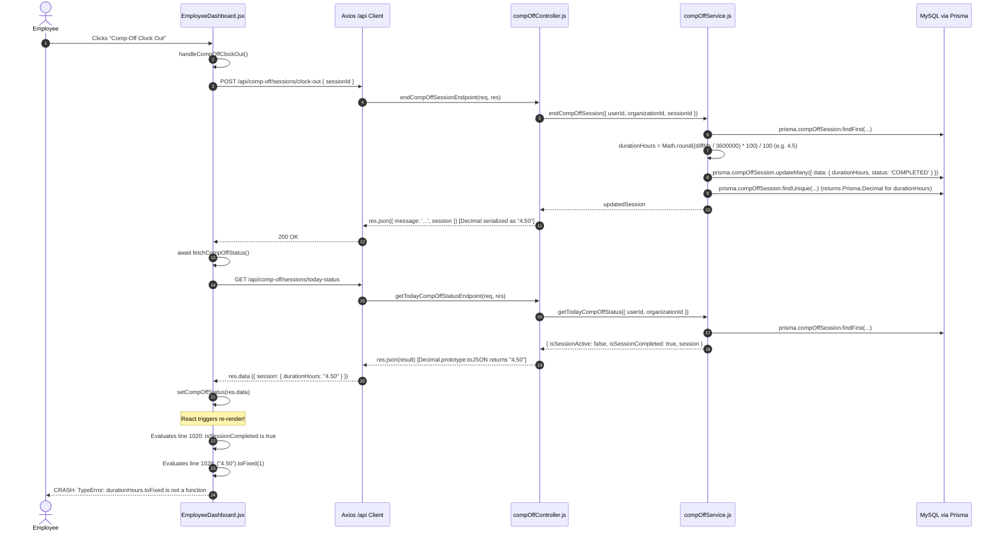

# Comprehensive Diagnostic Report: Comp-Off Clock-Out Runtime TypeError

**File:** `compoff_clockout_error_diagnostic.md`  
**Generated Date:** October 22, 2026  
**Status:** Investigation Complete (Analysis Only — No code or data modified)

---

## Executive Summary

When an employee completes a Comp-Off clock-out from the Employee Dashboard, React crashes with an unhandled TypeError:
```text
TypeError: compOffStatus.session.durationHours.toFixed is not a function
at EmployeeDashboard.jsx:1029
```

This diagnostic investigation traced the end-to-end execution path from the frontend button click through the backend controller, database schema, Prisma ORM serialization, and React re-render.

**The fundamental root cause is an ORM data type mismatch:**
1. In `backend/prisma/schema.prisma`, `CompOffSession.durationHours` is declared as `@db.Decimal(5, 2)`.
2. Prisma Client instantiates this as a `Prisma.Decimal` (using `Decimal.js`).
3. When serialized to JSON by Express (`res.json()`), `Decimal.js` serializes decimals as JSON strings (e.g., `"4.50"` or `"0.00"`) to prevent IEEE-754 floating-point precision loss.
4. When `EmployeeDashboard.jsx` receives the updated session upon clock-out, `compOffStatus.session.durationHours` is a JavaScript `string`, not a `number`.
5. The dashboard condition checks truthiness (`compOffStatus.session?.durationHours ? ...`), which evaluates to `true` for any non-empty string.
6. The code then directly invokes `.toFixed(1)`. Because `String.prototype.toFixed` does not exist, JavaScript immediately throws `TypeError: compOffStatus.session.durationHours.toFixed is not a function`, crashing the component into the React Error Boundary.

---

## 1. Exact Error and Source Location

### Browser Error
```text
TypeError: compOffStatus.session.durationHours.toFixed is not a function
    at EmployeeDashboard (EmployeeDashboard.jsx:1029:85)
```

### Source Location
**File:** [frontend/src/components/dashboard/EmployeeDashboard.jsx:1020-1030](file:///d:/P%20R%20O%20J%20E%20C%20T%20S/Web/MRF-crm/frontend/src/components/dashboard/EmployeeDashboard.jsx#L1020-L1030)

```jsx
1020: ) : compOffStatus?.isSessionCompleted ? (
1021:   <motion.div
1022:     key="emp-card-compoff-completed"
1023:     initial={{ opacity: 0, scale: 0.95 }}
1024:     animate={{ opacity: 1, scale: 1 }}
1025:     exit={{ opacity: 0, scale: 0.95 }}
1026:     transition={{ duration: 0.2 }}
1027:     className="w-full px-3 py-1.5 rounded-xl bg-violet-500/10 border border-violet-500/20 text-violet-700 dark:text-violet-300 text-[11px] font-bold text-center"
1028:   >
1029:     Comp-Off Worked: {compOffStatus.session?.durationHours ? `${compOffStatus.session.durationHours.toFixed(1)}h` : 'Completed'}
1030:   </motion.div>
```

### Failing Expression
```javascript
compOffStatus.session.durationHours.toFixed(1)
```

### Component State Lifecycle
- **State Declaration:** Line 99: `const [compOffStatus, setCompOffStatus] = useState(null);`
- **Initial Fetch:** Line 326–327 in `fetchEmployeeDashboardData` calls `api.get('/comp-off/sessions/today-status')` and invokes `setCompOffStatus(compOffData)`.
- **Clock-Out Action:** Lines 377–389 in `handleCompOffClockOut`:
  ```javascript
  const handleCompOffClockOut = async () => {
    try {
      setCompOffActionLoading(true);
      await api.post('/comp-off/sessions/clock-out', {
        sessionId: compOffStatus?.session?.id
      });
      await fetchCompOffStatus();
      await fetchEmployeeDashboardData();
    } catch (err) {
      console.error('Comp-Off Clock Out error:', err);
    } finally {
      setCompOffActionLoading(false);
    }
  };
  ```
- **Post-Clock-Out Update:** `fetchCompOffStatus()` calls `GET /api/comp-off/sessions/today-status` and executes `setCompOffStatus(res.data)`.
- **Conditional Branch Switch:** Prior to clock-out, `compOffStatus.isSessionActive` was `true`, rendering the Clock-Out button branch (lines 995–1019) and computing elapsed time from `loginTime` (`compOffElapsedText`), never touching `session.durationHours`. Once clocked out, `isSessionActive` becomes `false` and `isSessionCompleted` becomes `true`. This causes React to enter the `compOffStatus?.isSessionCompleted` branch for the first time, executing line 1029.

---

## 2. Relevant Code Flow: Complete Frontend-to-Backend Trace



---

## 3. Expected vs. Actual Data Type

| Layer / Stage | Expected Type | Actual Runtime Type | Value Example | Explanation |
| :--- | :--- | :--- | :--- | :--- |
| **MySQL Column** | `DECIMAL(5, 2)` | `DECIMAL(5, 2)` | `4.50` | Table definition in database. |
| **Prisma Query Result** | `Number` | `Prisma.Decimal` (object) | `new Decimal("4.5")` | Prisma maps `@db.Decimal` to `Decimal.js` instances. |
| **Express `res.json()`** | `Number` | `String` | `"4.50"` | `Decimal.prototype.toJSON()` yields a string. |
| **Axios Response Payload** | `Number` | `String` | `"4.50"` | JSON parser parses `"4.50"` as a string. |
| **`compOffStatus.session.durationHours`** | `number` (or `null`/`undefined`) | `string` | `"4.50"` | Stored directly in React state. |
| **`compOffStatus.session.durationHours.toFixed`** | `Function` (`Number.prototype.toFixed`) | `undefined` | `undefined` | `String.prototype.toFixed` does not exist. |

---

## 4. Root-Cause Evidence

### 1. Database Schema Definition
In `backend/prisma/schema.prisma` at line 2613:
```prisma
model CompOffSession {
  id                  String                   @id @default(uuid())
  ...
  durationHours       Decimal                  @default(0.00) @db.Decimal(5, 2)
  ...
```

### 2. Contrast with Normal Attendance (`Attendance` model)
In `backend/prisma/schema.prisma` at line 519:
```prisma
model Attendance {
  ...
  workingHours Float?           // Decimals representing decimal hours
  ...
```
Because `Attendance.workingHours` is defined as a `Float`, Prisma returns a native JavaScript `Number`. When serialized by Express, it outputs `4.5` (a JSON number). Thus, in `EmployeeDashboard.jsx:764`:
```javascript
subtitle: `Shift completed (${clockedRecord.workingHours?.toFixed(1) || 0} hrs)`
```
This succeeds without error for normal attendance.

### 3. Contrast with `listCompOffSessions` in `compOffService.js`
In `backend/src/services/compOffService.js` at line 2394 & 2423, the author had explicitly noted the Decimal-to-number requirement:
```javascript
const durationHours = parseFloat(sess.durationHours) || 0;
...
return {
  ...sess,
  durationHours, // Explicitly converted to float number
  ...
};
```
However, in `getTodayCompOffStatus` (lines 1440, 1458) and `endCompOffSession` (line 1802), the raw Prisma record is returned directly without normalizing `durationHours` to a float.

### 4. Contrast with `CompOffManagementSection.jsx`
In `frontend/src/components/leave/CompOffManagementSection.jsx` at line 882 & 912, defensive parsing was previously implemented:
```javascript
durationHours: session?.durationHours !== undefined && session?.durationHours !== null ? parseFloat(session.durationHours) : null,
```
And at line 2101:
```javascript
{Number(s.durationHours) > 0 ? `${s.durationHours} hrs` : 'In progress'}
```

### 5. Flawed Assumptions in `EmployeeDashboard.jsx` and `Attendance.jsx`
1. Assumed `durationHours` is a JavaScript `number`.
2. Assumed `compOffStatus.session?.durationHours ? ...` verifies that `durationHours` is a valid number with number methods, whereas in JS `"4.50"` and `"0.00"` are truthy strings.
3. Optional chaining `?.toFixed` would only prevent errors if `durationHours` were `null` or `undefined`. When `durationHours` is a string, `"4.50"?.toFixed` returns `undefined`, and invoking `undefined(1)` throws `TypeError`.

---

## 5. Other Affected Usages Across the Codebase

A repository-wide search was conducted for `.toFixed` and `durationHours`. The exact same vulnerability exists in three additional locations:

1. **`frontend/src/pages/Attendance.jsx:815`**
   ```jsx
   Comp-Off Session Completed Today ({compOffStatus.session?.durationHours ? `${compOffStatus.session.durationHours.toFixed(1)} hrs` : 'Logged Out'})
   ```
   *Impact:* When an employee clocks out on `/attendance` or visits `/attendance` after completing Comp-Off, `/attendance` will crash with `TypeError: compOffStatus.session.durationHours.toFixed is not a function`.

2. **`frontend/src/components/leave/CompOffSessionCard.jsx:129`**
   ```jsx
   Comp-Off Worked: {session?.durationHours ? `${session.durationHours.toFixed(1)}h` : 'Completed'}
   ```
   *Impact:* When rendered for a completed session, crashes with the same TypeError.

3. **`frontend/src/components/leave/CompOffSessionCard.jsx:299`**
   ```jsx
   {session?.durationHours?.toFixed(1) || '0.0'} Hours Logged
   ```
   *Impact:* Crashes because `session?.durationHours?.toFixed` is `undefined`, and invoking it throws `TypeError: session?.durationHours?.toFixed is not a function`.

---

## 6. Confirmation Classification

| Item | Status | Supporting Evidence |
| :--- | :--- | :--- |
| **Error line & expression** | **CONFIRMED** | `EmployeeDashboard.jsx:1029`: `compOffStatus.session.durationHours.toFixed(1)`. |
| **Data type of `durationHours`** | **CONFIRMED** | Prisma schema line 2613 (`@db.Decimal(5, 2)`). Prisma Decimal serializes to string in JSON. |
| **Why error happens only AFTER clock-out** | **CONFIRMED** | During active session, `isSessionActive` is `true` and the UI shows the Clock-Out button + elapsed timer. Line 1029 is in the `isSessionCompleted` branch and is only evaluated after clock-out. |
| **`Attendance.jsx` has identical bug** | **CONFIRMED** | `Attendance.jsx:815` uses identical expression on `compOffStatus.session.durationHours.toFixed(1)`. |
| **`CompOffSessionCard.jsx` has identical bug** | **CONFIRMED** | Lines 129 & 299 use `.toFixed(1)` directly on `session.durationHours`. |
| **Normal attendance uses `Float`** | **CONFIRMED** | `schema.prisma:519` defines `workingHours Float?`, which serializes as native JS `Number`. |

---

## 7. Recommended Smallest Safe Fix (For Future Implementation)

To achieve complete reliability without breaking existing workflows, a two-tier fix is recommended:

### Tier 1: Backend Response Normalization (Authoritative Fix)
Normalize `durationHours` in `getTodayCompOffStatus` and `endCompOffSession` so the API consistently returns numeric values matching `Attendance.workingHours`.

In `backend/src/services/compOffService.js`:
Create a lightweight session normalizer:
```javascript
const formatCompOffSessionResponse = (session) => {
  if (!session) return null;
  return {
    ...session,
    durationHours: session.durationHours !== null && session.durationHours !== undefined
      ? parseFloat(session.durationHours)
      : 0
  };
};
```
Apply this helper when returning `session` in:
- `getTodayCompOffStatus` (lines 1440, 1458)
- `endCompOffSession` (line 1802)
- `startCompOffSession` (line 1736)

### Tier 2: Frontend Defensive Formatting (Resilience Fix)
Do not assume `durationHours` is always a primitive number. Safely parse and format in all frontend components.

A safe formatting helper:
```javascript
const formatHours = (hours, fallback = 'Completed') => {
  if (hours === null || hours === undefined || hours === '') return fallback;
  const num = Number(hours);
  if (Number.isNaN(num) || num <= 0) return fallback;
  return `${num.toFixed(1)}h`;
};
```

Update the affected frontend locations:
1. **`EmployeeDashboard.jsx:1029`**:
   ```jsx
   Comp-Off Worked: {Number(compOffStatus.session?.durationHours) > 0 ? `${Number(compOffStatus.session.durationHours).toFixed(1)}h` : 'Completed'}
   ```
2. **`Attendance.jsx:815`**:
   ```jsx
   Comp-Off Session Completed Today ({Number(compOffStatus.session?.durationHours) > 0 ? `${Number(compOffStatus.session.durationHours).toFixed(1)} hrs` : 'Logged Out'})
   ```
3. **`CompOffSessionCard.jsx:129 & 299`**:
   ```jsx
   Comp-Off Worked: {Number(session?.durationHours) > 0 ? `${Number(session.durationHours).toFixed(1)}h` : 'Completed'}
   ```
   and
   ```jsx
   {Number(session?.durationHours || 0).toFixed(1)} Hours Logged
   ```

*Why this approach is minimal and safe:*
- No database migrations or schema alterations required.
- No changes to existing calculations, payroll rules, or attendance logic.
- Both layers become robust against string decimals, numbers, nulls, and undefined.

---

## 8. Tests Required After Approval

When the fix is approved for implementation, the following tests should be run:
1. **Unit / Pure Logic Test:** Verify that `formatHours` correctly handles `null`, `undefined`, `"0.00"`, `0`, `"4.50"`, `4.5`, and invalid strings without throwing.
2. **Backend API Test:** Verify `GET /api/comp-off/sessions/today-status` returns `session.durationHours` as a numeric type (`typeof res.data.session.durationHours === 'number'`).
3. **Frontend Integration Test:**
   - Simulate completed Comp-Off session payload with `"durationHours": "5.25"`.
   - Mount `EmployeeDashboard.jsx` and verify it renders `"Comp-Off Worked: 5.3h"` without crashing.
   - Mount `Attendance.jsx` and verify it renders `"Comp-Off Session Completed Today (5.3 hrs)"` without crashing.
   - Mount `CompOffSessionCard.jsx` and verify it renders `"5.3 Hours Logged"` without crashing.

---

## 9. Unresolved Questions

None. The exact stack trace, failing expression, ORM column type, JSON serialization mechanism, and frontend rendering branches were confirmed through source code inspection and cross-component verification.
